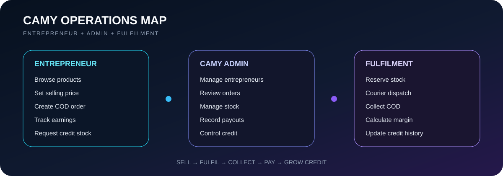
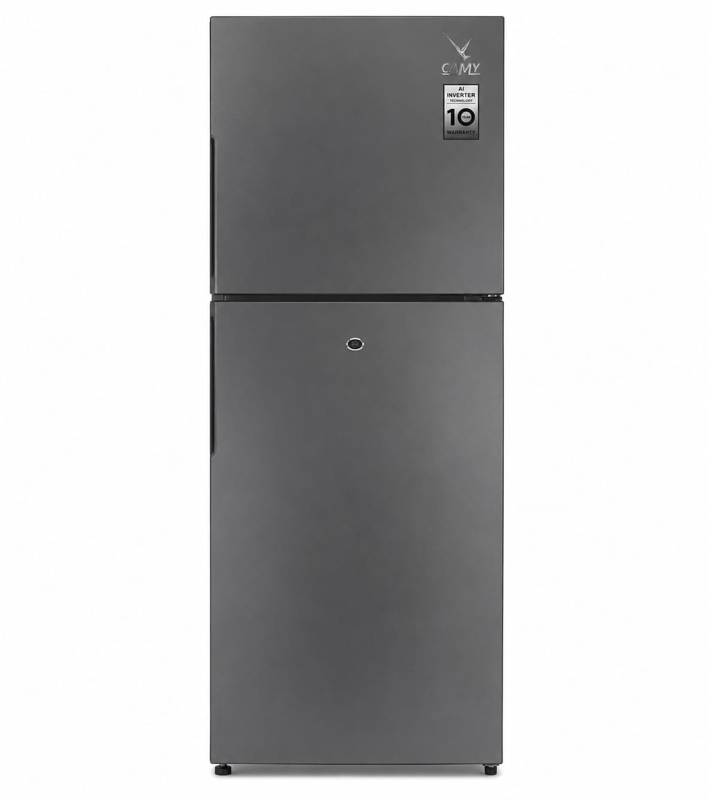
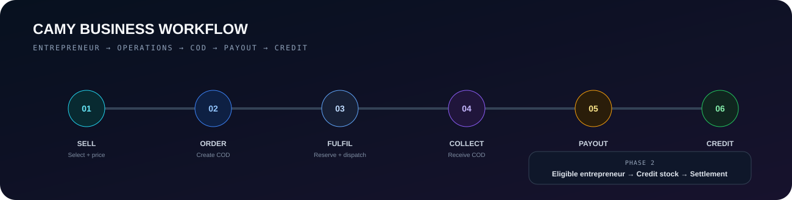

<p align="center">
  
</p>

<p align="center">
  <b>Entrepreneur selling • COD fulfilment • payouts • stock • credit operations</b>
</p>

<p align="center">
  🌐 <b>Live Platform:</b> <a href="https://camymarket.com/">https://camymarket.com/</a>
</p>

<p align="center">
  
  
  
</p>

## ✦ Platform at a Glance

<p align="center">
  
</p>

## ✦ Product Experience

<div align="center">
<table>
<tr>
<td align="center"><br/><b>Air Conditioners</b></td>
<td align="center"><br/><b>Smart TVs</b></td>
<td align="center"><br/><b>Cookware</b></td>
<td align="center"><br/><b>Refrigerators</b></td>
</tr>
</table>
</div>

## ✦ Business Workflow

<p align="center">
  
</p>

## What It Solves

CAMY connects the full entrepreneur operations cycle in one place: **sell → reserve stock → dispatch → collect COD → calculate profit → pay entrepreneur → build credit eligibility**.

### Entrepreneur
- Browse products and set own selling price
- Place COD client orders
- Track order progress, earnings and payouts
- Request credit stock when eligible

### CAMY Admin
- Manage entrepreneurs, products and warehouse stock
- Review orders and courier information
- Record payouts and settlements
- Control credit limits and credit-stock requests

## Why This Project Matters

- Real multi-role business workflow, not only a catalogue
- Stock and credit validation on the server side
- COD + entrepreneur profit logic in one system
- Operational database checks and payout-ledger consistency

## Tech Stack


## Run Locally

```powershell
npm.cmd install
npm.cmd run dev
```

```powershell
npm.cmd run db:setup
npm.cmd run db:check
npm.cmd run build
```

---

```powershell
npm.cmd run php:version
```

The GitHub quality workflow also checks React build, PHP syntax, a clean MySQL schema/bootstrap and the end-to-end COD + entrepreneur payout + Phase 2 credit-stock flow.

## Important files

- `src/DropshipMarketplace.jsx` — COD client orders and Phase 2 credit stock
- `src/App.jsx` — entrepreneur/admin application shell
- `api/workflow.php` — COD order + payout workflow
- `api/marketplace.php` — state, fulfilment and Phase 2 credit stock
- `api/config.php` — database connection and automatic migrations
- `database/schema.sql` — MySQL schema
- `scripts/test-dropship-payout.php` — end-to-end business-flow integration test
- `CURRENT-DROPSHIP-FLOW.md` — current process reference

The old public customer marketplace and `src/MarketplaceLegacy.jsx` are retained only for migration/history compatibility and are not part of the active ordering flow.

Viewer-only access: in **Users & Access**, choose **Add user**, enter the person's name and email, and select **Viewer**. The system generates a temporary password and requires a password change on first sign-in. Existing staff can also be reassigned to Viewer. This built-in role can browse operational pages and reports but cannot create, update, upload, approve, or delete business records. The API enforces read-only access on every route. Viewers may change their own password and sign out; staff account management remains Super Admin-only.

Customer orders now shows COD, assisted COD and direct sales in one filtered table. The Excel export starts with the same filtered sales summary. Super Admins can correct buyer details, sale date, product quantities/prices and direct payment entries, or permanently delete a mistaken sale after entering a reason and the exact sale ID. Corrections use a concurrency token; stock, entrepreneur totals and report data update transactionally. Deleted sales and their related database rows and receipt files are removed. A correction to a paid commission flags finance reconciliation and preserves the actual transfer amount. Viewer accounts cannot edit or delete sales.

Direct sale entry starts with item selection. Packaging and delivery charges are visible checkboxes (included initially); unticking removes the chosen charge without adding it twice. Per-item discounts show the original and final unit prices. Printed and downloaded invoices use the official red CAMY logo and the Wellawatte/Supun Arcade address, with stored sale prices, a simple product table, discount totals and page numbers for PDF exports.

Direct sale entry no longer displays More price options or a separate Price approval section. Authorized price approval follows the signed-in role during save. Receipt upload is optional for direct-sale bank payments; a reference is required and payments remain pending until Finance verifies them. Uploaded documents are still validated when supplied. Other payment workflows retain their existing requirements.

Direct-sale details use clear received/pending/cancelled labels instead of exposing Not released as the main status. The overview focuses on payments and cancellation. Goods collection/delivery controls remain available in a collapsed section; cash receipt and item collection still update independently so stock is not reduced just because money was received.
<p align="center"><b>Built around a complete real-world operations flow.</b></p>
