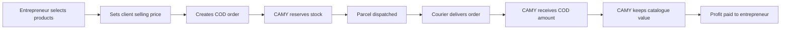
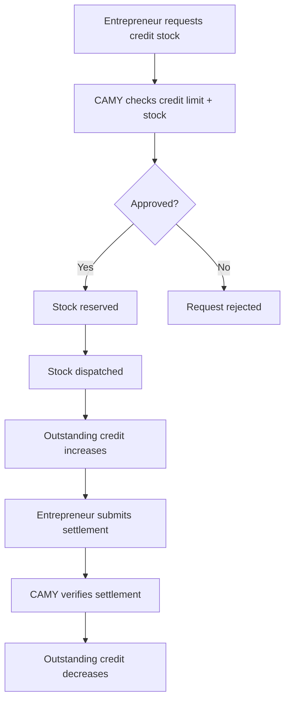

<div align="center">
  

  # CAMY Entrepreneurs Digital Platform

  **A modern operations platform connecting CAMY Admin and Entrepreneurs — from product selling to COD fulfilment, profit payouts and credit-stock management.**

  <p>
    
    
    
    
  </p>

  <p>
    
    
    
    
  </p>
</div>

---

## ✨ What is CAMY?

CAMY is an **Entrepreneur + CAMY Admin digital operations platform** designed to make selling and fulfilment easier.

Entrepreneurs sell CAMY products to their own clients, while the platform handles the operational flow behind the scenes — including **warehouse stock, COD orders, courier tracking, entrepreneur profit payouts and credit-stock management**.

> **There is no active customer portal.** Entrepreneurs manage their own clients through CAMY.

---

## 🚀 Core Features

| 👤 Entrepreneur | 🛡️ CAMY Admin | 📦 Operations |
|---|---|---|
| Browse CAMY products | Manage entrepreneurs | Warehouse stock control |
| Set own client selling price | Review & manage orders | Stock reservation |
| Place COD client orders | Add courier/tracking details | COD fulfilment workflow |
| Track order progress | Record entrepreneur payouts | Profit calculation |
| View earnings & payouts | Manage credit eligibility | Credit-stock fulfilment |
| Request credit stock | Approve/reject credit requests | Settlement tracking |

---

## 🛍️ Product Showcase

<div align="center">
  <table>
    <tr>
      <td align="center" width="25%"><br/><b>Air Conditioners</b></td>
      <td align="center" width="25%"><br/><b>Smart TVs</b></td>
      <td align="center" width="25%"><br/><b>Cookware</b></td>
      <td align="center" width="25%"><br/><b>Refrigerators</b></td>
    </tr>
  </table>
</div>

---

## 💸 Drop-shipping Flow



### How it works

1. Entrepreneur chooses CAMY products and sets their own client selling price.
2. Entrepreneur enters the client's delivery details.
3. Orders are **Cash on Delivery only**.
4. CAMY reserves warehouse stock and prepares the parcel.
5. CAMY records courier and tracking information.
6. After successful delivery, CAMY receives the full COD payment.
7. CAMY keeps the catalogue value.
8. The remaining margin becomes the entrepreneur's profit.
9. CAMY records the payout reference and receipt.
10. Successfully delivered product value contributes toward future credit eligibility.

---

## 💳 Phase 2 — Credit Stock

Once an entrepreneur reaches a CAMY-configured credit tier, they can continue using normal drop-shipping **and** optionally request credit stock.



### Credit rules

- No upfront payment is required for a credit-stock request.
- Multiple unpaid credit orders are allowed while total outstanding credit stays within the entrepreneur's limit.
- **Tier 1:** 21 days to settle each order.
- **Higher tiers:** 10 days to settle each order.
- Entrepreneurs can request extra time.
- CAMY Admin can approve or reject deadline-extension requests.
- An unpaid order does not hide the catalogue or automatically block a new request.

---

## 🧠 Platform Highlights

- ⚡ Shared state refresh instead of duplicate page polling
- 👁️ Visible-tab-only polling
- 🔐 Server-side stock and credit validation
- 🔒 Database transactions and write-only row locking
- 📊 Bulk payout-ledger hydration
- 🧹 Automatic inactive-account maintenance
- 🚀 Operational indexes for common order and credit queries
- 📱 Public entrepreneur registration with QR support

---

## 🛠️ Tech Stack

| Layer | Technology |
|---|---|
| Frontend | React + Vite |
| Backend API | PHP |
| Database | MySQL |
| Local Environment | XAMPP |
| Icons | Lucide React |
| QR Codes | QRCode React |
| Spreadsheet Support | ExcelJS |

---

## 💻 Local Development Setup

### Requirements

- Windows
- XAMPP
- XAMPP MySQL running
- Node.js + npm

CAMY automatically detects PHP from your `PATH` and common XAMPP locations on available Windows drives. XAMPP does **not** need to be installed in `C:\xampp`.

### Default local database

```text
Host: 127.0.0.1
Port: 3306
Database: camy_new
User: root
Password: empty
```

For a custom XAMPP folder, set PHP manually for the current PowerShell session:

```powershell
$env:CAMY_PHP_PATH="D:\xammp\php\php.exe"
```

Verify PHP:

```powershell
npm.cmd run php:version
```

---

## ▶️ Run the Project

Start **MySQL** in XAMPP, then run:

```powershell
npm.cmd install
npm.cmd run dev
```

### Development URLs

| Service | URL |
|---|---|
| 🌐 Web App | `http://127.0.0.1:8080` |
| 📝 Entrepreneur Registration | `http://127.0.0.1:8080/register` |
| ⚙️ PHP API | `http://127.0.0.1:8000` |
| ❤️ API Health | `http://127.0.0.1:8080/api/health` |

`npm run dev` checks MySQL, creates `camy_new` when missing, applies the current schema/migrations and starts both PHP + Vite.

---

## 🌍 Public Deployment URL

For a deployed site, set `VITE_PUBLIC_URL` before building:

```powershell
$env:VITE_PUBLIC_URL="https://camy.example.com"
npm.cmd run build
```

The admin registration QR code and copied registration link use this value.

> ⚠️ Do not share a QR code containing `localhost` or `127.0.0.1`. Those addresses only work on the computer running CAMY.

---

## 🗄️ Database Commands

### Setup / update database

```powershell
npm.cmd run db:setup
```

This applies the current local database schema without deleting existing records.

### Reset database

```powershell
npm.cmd run db:reset
```

> ⚠️ **Warning:** `db:reset` deletes all data. Do not use it for normal updates.

### Database health check

```powershell
npm.cmd run db:check
```

This validates required tables, indexes, active credit commitments, payout-ledger consistency and other important database rules without deleting records.

---

## 🧹 Production Legacy Cleanup

After backing up the hosted database, run:

```powershell
npm.cmd run db:cleanup
```

The cleanup command:

- targets only retired order/customer-account tables
- creates a restorable SQL backup in `private/database-backups/`
- stops before deleting tables when records are found

After reviewing the backup, deliberate cleanup with existing data can be run using:

```powershell
npm.cmd run db:cleanup -- --allow-data
```

Active tables such as `customer_order_groups`, `shop_orders`, `shop_order_items`, `entrepreneur_payouts`, stock, security and marketplace tables are **not** cleanup targets.

A fresh database may generate temporary admin credentials in:

```text
private/bootstrap-credentials.txt
```

---

## ✅ Quality Checks

```powershell
npm.cmd run build
npm.cmd run php:version
npm.cmd run db:check
```

The GitHub quality workflow also checks:

- React production build
- PHP syntax
- clean MySQL schema/bootstrap
- end-to-end COD workflow
- entrepreneur payout flow
- Phase 2 credit-stock flow

---

## 📁 Important Files

```text
src/DropshipMarketplace.jsx     COD client orders + Phase 2 credit stock
src/App.jsx                     Entrepreneur/Admin application shell
api/workflow.php                COD order + payout workflow
api/marketplace.php             Marketplace state + fulfilment + credit stock
api/config.php                  Database connection + automatic migrations
database/schema.sql             MySQL database schema
scripts/test-dropship-payout.php End-to-end workflow integration test
CURRENT-DROPSHIP-FLOW.md        Current business-process reference
```

> The old public customer marketplace and `src/MarketplaceLegacy.jsx` remain only for migration/history compatibility and are **not part of the active ordering flow**.

---

<div align="center">
  

  ### Built to simplify CAMY entrepreneur operations 🚀

  **Sell • Fulfil • Track • Earn • Grow**
</div>
