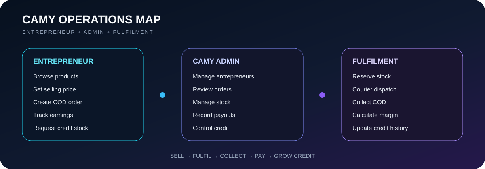
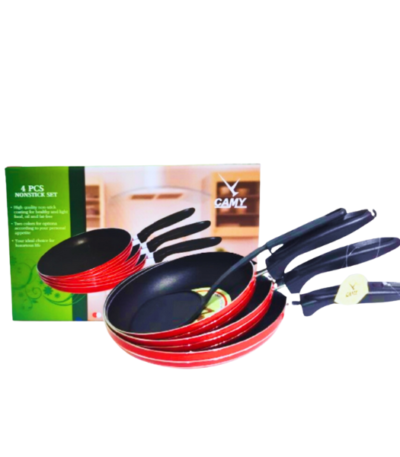
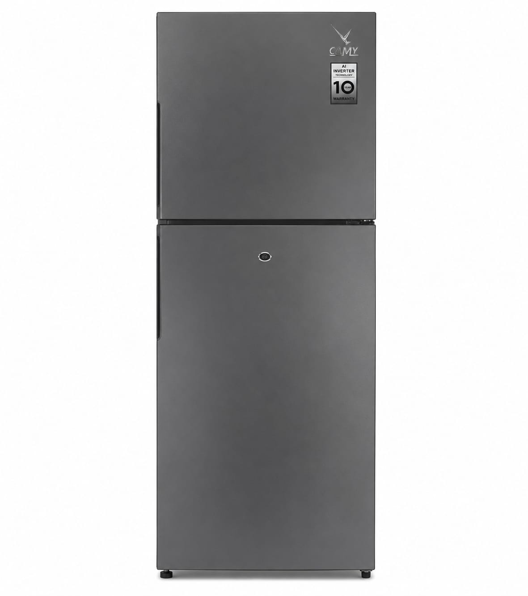
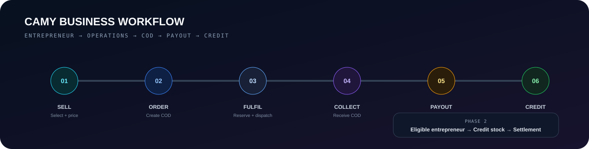

<p align="center">
  
</p>

<p align="center">
  <b>Entrepreneur selling • COD fulfilment • payouts • stock • credit operations</b>
</p>

<p align="center">
  
  
  
</p>

## ✦ Platform at a Glance

<p align="center">
  
</p>

## ✦ Product Experience

<div align="center">
<table>
<tr>
<td align="center"><br/><b>Air Conditioners</b></td>
<td align="center"><br/><b>Smart TVs</b></td>
<td align="center"><br/><b>Cookware</b></td>
<td align="center"><br/><b>Refrigerators</b></td>
</tr>
</table>
</div>

## ✦ Business Workflow

<p align="center">
  
</p>

## What It Solves

CAMY connects the full entrepreneur operations cycle in one place: **sell → reserve stock → dispatch → collect COD → calculate profit → pay entrepreneur → build credit eligibility**.

### Entrepreneur
- Browse products and set own selling price
- Place COD client orders
- Track order progress, earnings and payouts
- Request credit stock when eligible

### CAMY Admin
- Manage entrepreneurs, products and warehouse stock
- Review orders and courier information
- Record payouts and settlements
- Control credit limits and credit-stock requests

## Why This Project Matters

- Real multi-role business workflow, not only a catalogue
- Stock and credit validation on the server side
- COD + entrepreneur profit logic in one system
- Operational database checks and payout-ledger consistency

## Tech Stack

`React + Vite` · `PHP` · `MySQL` · `XAMPP`

## Run Locally

```powershell
npm.cmd install
npm.cmd run dev
```

```powershell
npm.cmd run db:setup
npm.cmd run db:check
npm.cmd run build
```

---

<p align="center"><b>Built around a complete real-world operations flow.</b></p>
